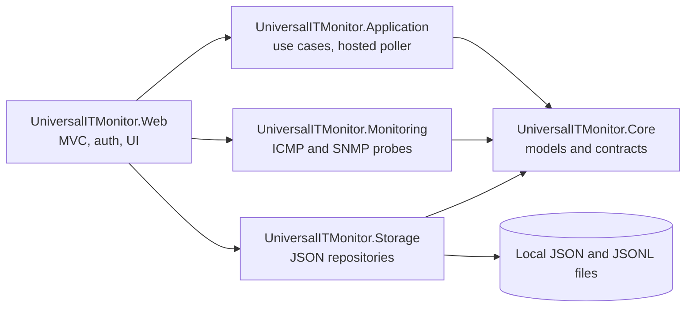

# Architecture

## Phase 1-6 decisions

- Keep the existing MVC app and split responsibilities across Web, Application, Core, Storage, and Monitoring projects.
- Use .NET 10, ASP.NET Core MVC, Bootstrap assets already in the checkout, and built-in dependency injection and cookie authentication.
- Use local JSON files rather than a database service. Data defaults to `App_Data` under the application folder, outside `wwwroot`; an absolute external path remains available for versioned releases.
- Keep HTTP, authentication, authorization, and Razor views in Web; application workflows and the hosted poller in Application; models and contracts in Core; JSON persistence in Storage; and network probes/SNMP OID queries in Monitoring.
- Start device health checks with ICMP. Optional SNMP collects read-only metrics. Do not report an unsupported OID as a measured value.
- Commit status changes and stable-ID pending transition events atomically in `devices.json`; replay the outbox idempotently into append-only JSONL history and notification records after crashes.
- Store location/group relationships, topology maps, and IPAM separately from device records while referencing devices through stable IDs.
- Store notification settings, delivery history, and monitoring check samples as separate JSON/JSONL data. Notification credentials use Data Protection; local user administration is backed by `users.json` and the existing password-hashing/authentication stack.
- Store backup scheduling and bounded operation history in JSON documents. Backups are ZIP snapshots with a versioned manifest and per-file SHA-256 hashes; they include the Data Protection key ring but do not encrypt the archive container.
- Coordinate snapshots, full/selected restores, monitoring, notification delivery, and ordinary web requests with the maintenance lock. A sidecar exclusive file lease enforces one active process per data directory during startup, IIS overlapped recycle, and shutdown.
- Write application logs as bounded, rotated, secret-redacted JSONL in the data directory. Flush each event and swallow storage IO failures so logging does not break monitoring.
- Keep IP assignment state explicit. Do not infer ownership from ICMP reachability or configure DHCP/network-device/OS address settings from IPAM.
- Keep the authenticated Live Ping tool as a temporary multi-target ICMP workflow; its probes do not write device inventory, IPAM data, or scheduled monitoring history.
- Save each JSON document atomically with per-document locks. Multi-document workflows are coordinated sequentially and the deployment target remains one application instance.

## Projects

| Project | Responsibility |
| --- | --- |
| `src/UniversalITMonitor.Web` | MVC controllers and views, cookie auth, role policies, antiforgery, request limits, device/report/user/backup screens, settings UI |
| `src/UniversalITMonitor.Application` | Account/user/device/structure/map/IPAM/report/notification/backup workflows, Data Protection secret wrappers, monitoring, notification, and automatic backup hosted workers |
| `src/UniversalITMonitor.Core` | Device/status/SNMP, hierarchy, map, IPAM, notification, backup, and sample models plus repository/probe contracts |
| `src/UniversalITMonitor.Storage` | Synchronized JSON documents, device/structure/map/IPAM/user/notification/backup repositories, JSONL history and check samples, per-device SNMP metric snapshots |
| `src/UniversalITMonitor.Monitoring` | ICMP probe and SNMP v2c/v3 read-only metric collector |

## Local data files

| Path under the configured data directory | Contents |
| --- | --- |
| `users.json` | Local usernames, ASP.NET Core password hashes, role assignments, enabled state, creation time |
| `roles.json` | Administrator, Operator, and ReadOnly role definitions |
| `settings.json` | Polling interval, maximum concurrent checks, and ping timeout |
| `branding.json`, `themes.json` | Product labels and theme tokens |
| `devices.json` | Device inventory and latest ICMP state/response/check timestamps |
| `inventory-structure.json` | Stable-ID locations (sites/buildings/areas) and nested groups |
| `network-maps.json` | Named map layouts, device-ID nodes with positions/sizes/icon kinds, and device-ID connections |
| `ipam.json` | IP records and normalized IPv4/IPv6 CIDR subnet registrations |
| `notification-settings.json` | Channel enablement, Telegram/SMTP configuration, and Data Protection ciphertext for credentials |
| `notification-history.json` | Notification transition/test records and per-channel delivery results; completed events are capped at 2,000 |
| `snmp-metrics/{device-id}.json` | Latest SNMP values for one device, written atomically with a recovery copy |
| `monitoring-history/{device-id}.jsonl` | Append-only status transition events for one device |
| `monitoring-samples/{device-id}.jsonl` | Append-only actual check samples used by response-time reports |
| `backup-settings.json` | Automatic backup enablement, interval, retention, destination directory, and next run time |
| `backup-history.json` | Bounded results for manual/automatic/safety backups and restores |
| `keys/` | ASP.NET Core Data Protection key ring |
| `logs/` | Redacted, rotated application log JSONL files |
| `inventory-reference-report.json` | Latest startup cross-document reconciliation report for Admin review |

`IJsonDocumentStore` accepts only simple `.json` file names. Reads and updates use an in-process semaphore and a cross-process exclusive lock file. Writes use a temporary file and atomic replacement, with the last valid document copied to `.bak`. A valid `.bak` is also recovered when the primary file is missing; invalid source and backup files are preserved and surfaced as an initialization error.

The history store writes one independent JSON object per line and uses per-device in-process and cross-process locks. The metrics store uses a separate bounded-size file per device so interface tables do not enlarge the main inventory document. Data and Data Protection keys stay outside `wwwroot`.

## Backup and restore

- The Admin-only backup service validates backup settings and destination paths, rejects paths within or above the data directory, under `wwwroot`, or inside the published application in Production, refuses linked directories, creates ZIPs through a temporary file, validates the finished archive, and records a bounded result history. Production data paths are absolute and external. Automatic, manual, and pre-restore safety archives are kept separate from live data; retention applies to manual and automatic archives, not safety archives.
- A manifest lists every archive path and SHA-256 digest. Validation rejects missing/duplicate/extra files, path traversal, symlink entries, oversized archives, unsupported future major versions, invalid required JSON, and inconsistent device, hierarchy, map, IPAM, user, or monitoring-setting references before any live data is changed.
- Restore extracts to a sibling staging directory on the same volume. Full restore validates the whole staged data set, writes destination-specific backup settings/history, creates a verified safety archive, then swaps the live directory with rollback if the swap fails. Selected-module restore starts from a copy of live data and validates the merged result; unsafe references and credentials that cannot be decrypted block the operation. The old directory is only removed after a successful swap.
- A writer-preferring maintenance lock prevents monitoring checks, notification delivery, and ordinary web requests from using data during snapshots or restore. The sidecar instance lease serializes overlapped IIS workers against the same store. Full restore requires application restart so repositories and Data Protection providers reload the restored directory. The restore endpoint schedules process shutdown after its response.
- Data Protection keys live in `keys/` and are included in backups. Credentials remain encrypted ciphertext and are validated using the archived key ring before restore. Production Windows defaults to DPAPI for the current IIS application-pool identity. Restoring those keys on another server requires the original DPAPI identity/profile/master-key context; this application does not transfer that context. For a planned migration, configure `DataProtection:CertificateThumbprint` in `LocalMachine\My` before protected credentials are created, grant the pool identity access to the private key, and preserve/install that certificate and private key on the target. This setting protects new keys and does not rewrap existing DPAPI-protected keys.
- A migration copies compatible published application files and configuration, the data directory, the configured backup directory, and the required Data Protection identity/key material. Stop the instance while copying, preserve the application name and settings, grant the IIS identity Modify access to data, its parent, backups, and key material, and validate a restore in a separate data directory before cutover. Existing ciphertext is never discarded when its key cannot be opened.

## Monitoring cycle

1. The hosted worker reads `settings.json` and clamps values to the supported range.
2. It loads enabled devices and performs ICMP checks with bounded parallelism. The default maximum is 20 concurrent checks.
3. When SNMP is configured, the collector queries system and interface OIDs in read-only mode, preferring 64-bit counters and falling back to legacy IF-MIB counters. Assigned VLAN is read from Cisco VLAN membership or BRIDGE/Q-BRIDGE PVID tables when exposed. CPU and memory remain optional. ICMP status remains independent of SNMP collection errors.
4. One atomic device document update records check times, response, current status, current-state start time, and an idempotent pending event for every transition in the completed batch.
5. The worker drains pending events into per-device JSONL history and an idempotent notification outbox, then acknowledges each event only after both writes succeed. Completed check results are appended as actual response-time samples. SNMP results are atomically saved separately per device.
6. A separate notification worker processes pending Telegram and email deliveries, recording each outcome without blocking the monitoring cycle.
7. The monitoring worker waits for the configured interval or an immediate-cycle signal from a device/settings change. Polling cycles do not overlap.

Current uptime or downtime is the elapsed time from the persisted `CurrentStateSinceUtc` timestamp. A first successful or failed probe changes UNKNOWN to UP or DOWN and starts that state duration. A paused device is retained in inventory and displays UNKNOWN.

SNMP v2c community strings and SNMP v3 authentication/privacy passwords are protected with ASP.NET Core Data Protection before writing to `devices.json`. The UI maps devices to secret-free view models, status JSON contains only safe fields, and CSV exports exclude SNMP configuration secrets. Production Windows deployments protect the Data Protection key ring with DPAPI for the current IIS identity. Keep that identity and key directory when restarting or upgrading.

## Live Ping and subnet discovery

Live Ping accepts multiple IP addresses or DNS names and repeatedly probes them while the page is open. It reports resolved address, response status, latency, raw TTL, reply size, loss, and last check. These page sessions are independent of the persistent `MonitoringWorker` device checks and are not stored as inventory/history records. Device and IPAM subnet discovery are one-time scans from the application server; both show ICMP-responsive hosts only. IPAM discovery uses registered IPv4 subnets and its Add/Update actions write explicit IPAM records without inferring assignment ownership from reachability.

## Authentication and access

- Local passwords use ASP.NET Core Identity's `PasswordHasher<TUser>`; raw passwords are never written to JSON.
- The first administrator is created only while `users.json` has no accounts. The setup page starts with username `admin`, requires the user to choose a password, is protected by antiforgery and rate-limited, and redirects to sign-in after the first user record is written.
- The authenticated cookie is HTTP-only, SameSite Strict, and expires after eight hours with sliding renewal.
- A fallback authorization policy requires authentication. Administrators manage settings; Administrators and Operators manage devices; all authenticated roles can view/search inventory, details, status, and export CSV.
- MVC unsafe methods use antiforgery validation. Login and first-run setup are rate-limited by client IP; five failed account attempts trigger a persisted 15-minute lockout. No built-in MFA is implemented; deployments must require administrator MFA through their access layer.
- Administrators and Operators manage device/location/group/map data under the existing device-management policy. IPAM record/subnet writes are Administrator-only; authenticated read-only users can search and view.
- User management and notification settings/test-send endpoints require the Administrator policy. User records are re-read when validating each cookie; disabled/deleted users lose access and current role changes take effect on the next request. Repository writes prevent disabling, demoting, or deleting the last active Administrator.
- Reports and CSV exports are available to authenticated roles. Notification credentials are mapped to safe view models and are never included in notification records or report/device exports.

## Notifications and reports

- Monitoring transitions receive stable event IDs and are enqueued idempotently in `notification-history.json`. DOWN transitions and DOWN-to-UP recovery transitions are sent; unchanged status checks do not enqueue records. Transient channel failures receive bounded backoff for up to five automatic attempts, then remain visible as dead letters for Admin retry. A process crash after a provider accepts a message but before its result is persisted can cause an at-least-once duplicate; external delivery is not transactional.
- Telegram uses Bot API HTTPS requests and SMTP email requires TLS. Telegram token, SMTP user, and SMTP password are protected using a dedicated Data Protection purpose. Provider exceptions are reduced to safe results and do not stop monitoring. Live Telegram and SMTP interoperability has not been verified against real accounts/servers.
- Reports use persisted transition events to calculate UP/DOWN/UNKNOWN intervals; unknown time is excluded from availability. A missing transition baseline is shown as unavailable or unverified. Per-check samples began with Phase 4, so older response-time history is not available. Location/group summaries and IPAM reports are current snapshots; no historical inventory snapshots are stored.
- CSV exports preserve a consistent column layout and protect spreadsheet formula cells. Printable report pages rely on browser print-to-PDF; the application does not generate a PDF file server-side.
- Monitoring samples are append-only and currently have no retention/compaction policy. Report ranges are limited to 366 days, but retrieving those ranges scans per-device JSONL data, which grows over time.

## Risks and next work

- Storage assumes one application instance with local files. It is not a distributed database or a multi-writer shared-network-file design.
- Windows DPAPI keys are tied to the identity/profile and DPAPI master-key context that created them. The application does not migrate that context; certificate wrapping can protect newly generated keys when configured before credentials are created.
- SNMP metrics vary by vendor and agent. CPU and memory remain unsupported when their standard MIB tables are absent; VLAN remains unavailable where the agent does not expose a supported membership/PVID table. Device Details can issue an on-demand read-only SNMP test and saves interface hide/show preferences in the browser.
- Legacy free-text device assignments are retained as compatibility snapshots while stable location/building/group IDs are authoritative. Startup migration fills missing IDs idempotently.
- Map nodes must reference existing device records. Device deletion removes its saved map nodes/connections; JSON import reports missing IDs and refuses to save until references are valid.
- IPAM prevents duplicate normalized IP records and validates records against selected registered subnets. Administrators can use ICMP discovery on registered IPv4 subnets from /22 through /32 and add one or multiple IP records; existing monitored devices are linked automatically. Assignment status remains explicit and is never inferred from reachability. CSV is supported; Excel is not.
- Device, map, and IPAM changes can touch more than one JSON document. Each file write is atomic, but there is no cross-document transaction if the process stops between those writes.
- Live SNMP v2c/v3 interoperability has not been verified against a responding agent. CPU/memory support remains dependent on standard MIB implementations.
- Active Directory settings and authentication are not present in this checkout. Local authentication is the supported sign-in method; no AD interoperability is claimed.
- Telegram/SMTP sender code, credential protection, alert transitions, bounded retries, dead-letter visibility, and test-send flow are implemented. External-provider success, provider rate limits, and SMTP relay behavior remain unverified until configured and tested in the deployment environment.
- Monitoring sample JSONL files are append-only without compaction or retention; long-running deployments should monitor local disk use.
- The exclusive sidecar file lock serializes a new worker behind the old one during IIS overlapped recycle. Configure one IIS worker and sufficient shutdown time; target-server recycle and shutdown behavior still require deployment verification.
- Notification delivery is at-least-once across a narrow crash window where an external provider accepts a message before the local delivery result is saved.
- Server-side PDF creation is not included; use the browser print dialog to save report pages as PDF.

## Windows Server and IIS runbooks

- [Deployment guide](../DEPLOYMENT_GUIDE.md) documents the self-contained `win-x64` publish, production configuration, IIS identity, ACL boundaries, TLS, upgrades, and rollback. The IIS server still requires ANCM from the Hosting Bundle.
- [IIS setup checklist](../IIS_SETUP_CHECKLIST.md) and [production test checklist](../PRODUCTION_TEST_CHECKLIST.md) are operator procedures. Blank checkboxes are not evidence of deployment validation.
- [Disaster recovery guide](../DISASTER_RECOVERY_GUIDE.md) explains validated restore, DPAPI constraints, certificate-protected Data Protection keys, and cross-server migration.
- Monitoring JSONL retention/compaction and trusted reverse-proxy middleware are not implemented. The runbooks explicitly prohibit external JSONL truncation and proxy-header trust without a code/configuration change and validation.

