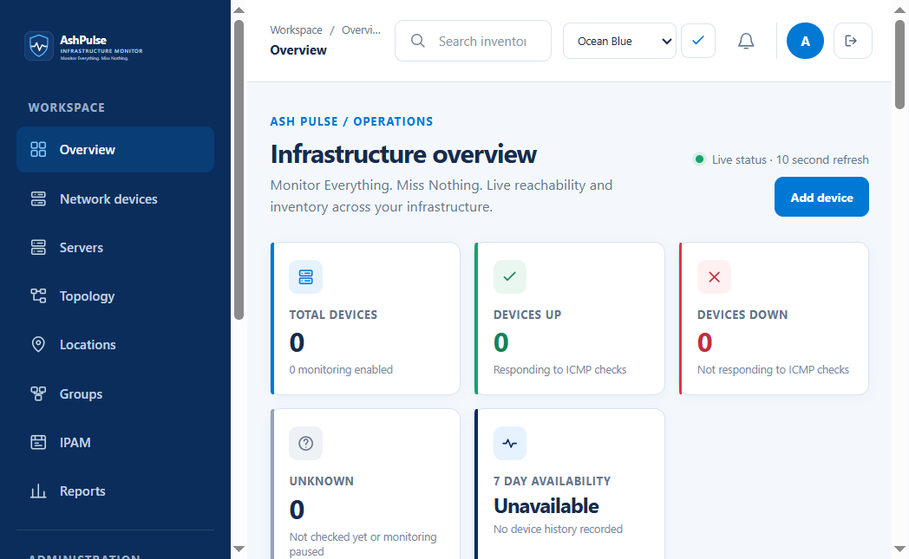
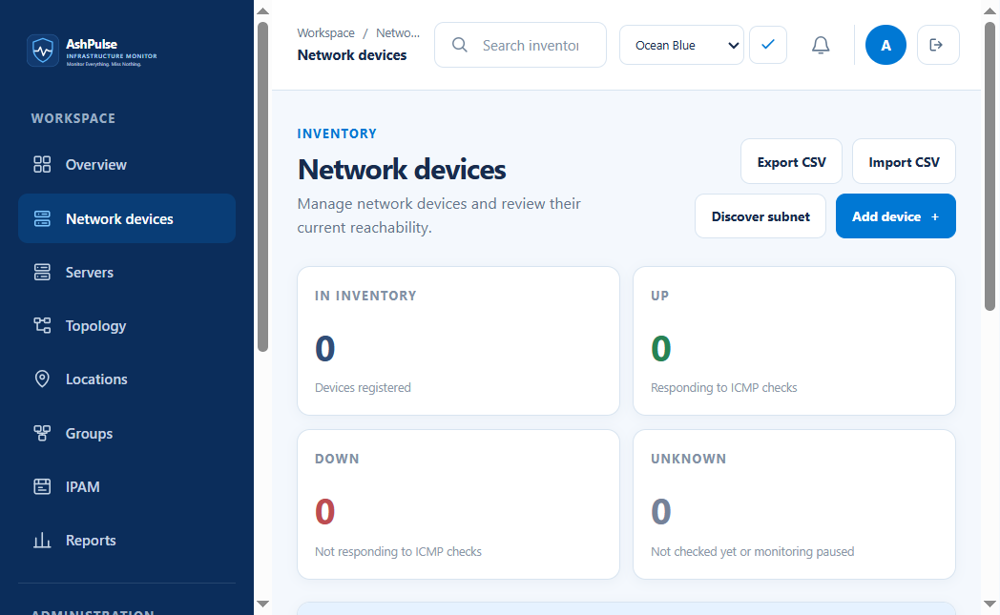

# AshPulse brand and UI redesign

AshPulse is the presentation layer for the existing Universal IT Monitor application. This redesign keeps its ASP.NET Core MVC/Razor structure, routes, data contracts, authorization, and monitoring workers.

## Brand system

Product name: **AshPulse**  
Full name: **AshPulse Infrastructure Monitor**  
Category: **Network and Server Monitoring**  
Tagline: **Monitor Everything. Miss Nothing.**

| Token | Color | Use |
| --- | --- | --- |
| Primary Navy | `#0B2D5B` | Sidebar, brand anchor |
| Electric Blue | `#0078D4` | Primary actions, selected controls, links |
| Light Blue | `#E6F2FF` | Selected and highlighted surfaces |
| Background | `#F4F8FD` | Application canvas |
| Card | `#FFFFFF` | Cards, forms, tables |
| Primary Text | `#172B4D` | Headings and content |
| Secondary Text | `#64748B` | Supporting labels |
| Success | `#16A36A` | Available status |
| Warning | `#E6A23C` | Warning status |
| Critical | `#DC3545` | Unavailable status |

Typography is Inter with Segoe UI, system UI, and platform sans-serif fallbacks. The application does not add a remote font dependency.

## Logo files

The SVG marks use a pulse waveform with network endpoints and an optional A-shaped trace. PNG icons are generated from the same mark.

- `src/UniversalITMonitor.Web/wwwroot/images/brand/logo-horizontal-light.svg` — horizontal mark for light surfaces.
- `src/UniversalITMonitor.Web/wwwroot/images/brand/logo-horizontal-dark.svg` — horizontal white mark for the navy sidebar.
- `src/UniversalITMonitor.Web/wwwroot/images/brand/ashpulse-app-icon.svg` — square vector application icon.
- `src/UniversalITMonitor.Web/wwwroot/images/brand/sidebar-icon.svg` — compact mark.
- `src/UniversalITMonitor.Web/wwwroot/favicon.svg`, `favicon.ico`, `favicon-32.png`, `favicon-192.png`, `favicon-512.png`, and `apple-touch-icon.png` — browser and installed-app icons.

## Shell and page treatment

The shared shell provides responsive navigation, page title and breadcrumb, existing global search, administrator-only theme selection and alert-delivery link, account identity, logout, and a compact mobile navigation drawer. Existing role checks determine which navigation links are shown. The Servers entry filters the existing device inventory by its `Server` type; it does not create a new inventory or route.

Ocean Blue is the default AshPulse palette. The known legacy Ocean Blue default is mapped to the AshPulse palette at render time, so existing `themes.json` data is not rewritten. Customized palettes remain intact. Midnight Purple and Emerald Green remain available through the existing appearance settings. Controls in the topology editor and inventory discovery UI use the selected theme tokens. Tables, forms, status badges, empty states, keyboard focus, and responsive layouts share the new system.

The overview dashboard reads device status, persisted status transitions, persisted successful ICMP response samples, latest SNMP values, notification delivery history, and existing location/group/IPAM stores. It calculates seven-day availability only from recorded transition history and shows history coverage. It reports recent transition/delivery history as recent alerts, not as an active-alert count. Missing telemetry is rendered as unavailable or an empty state; no sample devices or synthetic metrics are added.

Existing devices, monitoring configuration, topology maps, notification delivery/configuration, reports, IPAM, locations, groups, user management, appearance, data integrity, and backups retain their MVC actions and forms. Navigation labels distinguish Monitoring settings and Alerts while their underlying controllers remain unchanged.

## Validation notes

The source Web project is the maintained deployment input. The checked-in `site/` folder is existing publish output and was not manually edited. Repository tests can validate application logic and authorization, but real ICMP/SNMP agents, Telegram/SMTP credentials, a target IIS server, and physical responsive devices need their actual environments for live verification.

Screenshots from the isolated preview are stored under `docs/screenshots/` when captured. They use an empty temporary data directory so no production inventory is exposed or altered.

## Preview screenshots

These images show the actual application running against an empty temporary data directory. The empty states are intentional; no sample inventory or metrics were introduced.

