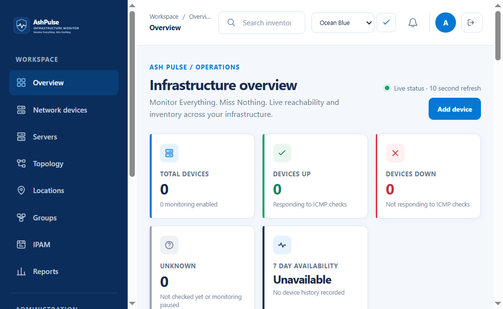
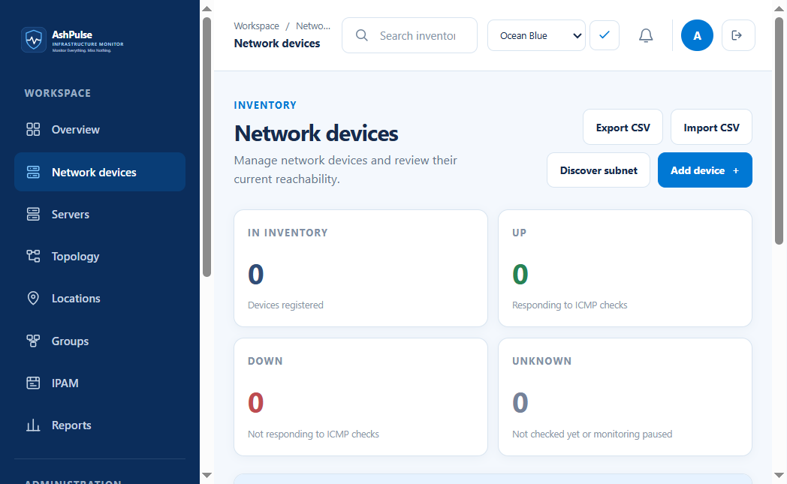

# AshPulse Infrastructure Monitor — User Guide

**Product:** AshPulse Infrastructure Monitor  
**Tagline:** Monitor Everything. Miss Nothing.

This guide explains how to use the features implemented in this release. Available pages and actions depend on your account role.

## 1. Sign in and understand access

Open the HTTPS address supplied by your administrator and sign in with your local account. On a new installation, first-run setup is available only until the first administrator is created. The username field starts with `admin`; the administrator chooses a password during setup. There is no permanent built-in default password.

The application uses local accounts. Repeated incorrect passwords can temporarily lock an account. Contact an administrator if your account is locked or disabled.

| Role | Typical access |
| --- | --- |
| Administrator | Full administration, user management, monitoring and notification settings, IPAM changes, backups/restores, and inventory management. |
| Operator | Device operations, device assignments, locations/groups, and topology map maintenance. Admin-only settings remain restricted. |
| Read-only | View and search permitted inventory, maps, locations/groups, IPAM, dashboard, and reports; export data where available. Cannot make changes. |

The server enforces permissions even when a restricted navigation item is not shown. Ask an administrator for actions your role cannot perform.

## 2. Read the overview dashboard

Overview summarizes current inventory and collected monitoring data. Counts come from current device records. A status history or availability figure is unavailable when persisted history is insufficient; the dashboard does not estimate missing values.

*This UI screenshot shows an empty inventory. Its counts and unavailable history are not production measurements.*

### Device status meanings

- **Up** — the latest ICMP check received a response.
- **Down** — the latest ICMP check did not receive a response.
- **Unknown** — no current result is available, or monitoring is paused.

SNMP is an additional metrics collection path. A SNMP collection error does not itself change ICMP reachability status.

## 3. Find devices

Use global search in the header to search device names and IP addresses, IPAM records, subnets, locations, groups, and saved maps. Open a device result for its current status and monitoring history. A small copy icon beside supported IP displays copies the address and briefly indicates success.

Use **Network devices** and **Servers** to review inventory. Filters narrow the list. Open a row to view current status, response time, last check, and any collected SNMP data. For SNMP-enabled devices, Device Details can show interface port state, live traffic rates, and VLAN when the agent exposes the relevant tables. Hide unused interfaces with **Hide**; use **Show hidden interfaces** to restore them in this browser. Administrators and Operators can run **Test SNMP now** to see the device's current response or error.

*This UI screenshot shows an empty inventory; it is a page reference, not live device data.*

## 4. Use Live Ping

Open **Ping** from the navigation menu. Enter an IPv4/IPv6 address or DNS name and select **Add & start ping**. Add more targets to watch them together. Each session repeats ICMP probes and displays the resolved IP, status, latency, raw TTL, reply bytes, packet loss, and last-check time. Failed or lost replies are highlighted in red; remove a row when you no longer need it.

Live Ping is an on-demand troubleshooting view. It does not create a monitored device or an IPAM record, and it does not replace the scheduled monitoring state shown in device inventory.

## 5. Add and maintain devices

Administrators and Operators can add, edit, pause/resume monitoring, import, discover, and remove devices. Read-only users can view the inventory but cannot change it.

### Add one device

1. Open **Network devices** or **Servers** and select **Add device**.
2. Enter a device name and IPv4 or IPv6 address.
3. Select the device type and assign a location, building, or group if appropriate.
4. Leave ICMP monitoring enabled to begin reachability checks. Configure optional SNMP fields only if the device supports them.
5. Save and open device details to review the first check.

The first check may take up to the configured polling interval. A device can show **Unknown** before a check completes.

### Discover responsive IPv4 devices

1. Select **Discover subnet** from the inventory.
2. Enter an IPv4 CIDR range. Supported scan sizes are `/22` through `/32`.
3. Start the scan and review returned addresses and suggested hostnames.
4. Select only approved devices to add. Discovery checks from the application server using ICMP; only responding hosts appear.
5. Add one or more selected devices and set their inventory details.

Discovery is not an ownership or authorization check. Scan only ranges you are authorized to monitor.

### Import and export device CSV

- Download the template from **Import devices**. Required columns are `DeviceName` (or `Name`) and `IpAddress`.
- Optional supported columns include device type, location, group, building, description, and monitoring enabled state.
- Review validation and duplicate-IP results before committing. Imported devices start with ICMP monitoring; add SNMP settings in the device editor if needed.
- Select **Export CSV** to download inventory. SNMP secrets are not included in exports.

### Pause or remove a device

Pausing monitoring retains the device in inventory and changes its current status to Unknown. Removing a device removes its inventory record and related topology map nodes/connections. Saved status-history files are retained on disk. Review the impact before deleting.

## 6. Configure optional SNMP

SNMP settings are available in the device editor. Choose the version supported by the device and enter its read-only access details and UDP port. SNMP v2c uses a community string. SNMP v3 uses a username and the configured security level/authentication/privacy fields.

Secrets are encrypted in local storage. The UI does not render saved secret values; leaving a secret field blank preserves the saved secret. Collection is read-only. For Cisco switches, the interface table can show port state, live traffic rates, and assigned VLAN when the device permits the needed IF-MIB, VLAN membership, or bridge PVID tables. Model, firmware, SNMP version, and agent view affect what is available; unsupported values remain blank. MikroTik and other agents likewise depend on their exposed MIBs. CPU and memory values may be unsupported. Use **Hide** to suppress an unnecessary interface in this browser and **Show hidden interfaces** to restore hidden rows.

Allow the application server to reach the approved device on the configured UDP port. Validate SNMP against the actual target network; a successful ping does not prove SNMP support.

## 7. Work with locations, groups, and topology

### Locations and groups

Locations represent a hierarchy such as site, building, or area. Groups represent operational groupings. Assign devices in the device editor. Location and group pages show devices under that node and its descendants with current status summaries.

Before deleting a location or group, reassign or explicitly unassign its devices and move child nodes as prompted. A device can remain in inventory without a location or group.

### Topology maps

1. Open **Topology** and create or open a map.
2. Scope it to a location/building if useful.
3. Drag existing inventory devices onto the canvas. Map nodes reference device IDs; they do not create separate device records.
4. Arrange, resize, and connect nodes. Choose from the available icon styles.
5. Save. Select a device node to open its details in the side inspector; IP addresses there and in device popups have the copy icon.
6. Use JSON export/import to move a map. Review missing device references in the import preview and resolve them before saving.

Removing a device from inventory also removes its map nodes and connections. A map export is not a full application backup.

## 8. Use IPAM

IPAM is an address-assignment inventory separate from monitoring. It can store IP address, subnet, VLAN, MAC, linked device, location/building/group, switch/port, department, assignee, description, and explicit assignment status.

- Register the subnet before assigning records to it where subnet validation is needed.
- Open **Discover subnet**, select a registered IPv4 subnet, and scan. Only addresses that answer ICMP from the application server are returned. Use **Add** beside a new address to enter its details, or select multiple new IPs and use **Add selected to IPAM**. Shared details apply to those records; a monitored device is linked automatically if its IP matches.
- An address already in IPAM offers **Update**. Open it to edit the existing entry instead of making a duplicate. Review assignment status, VLAN, location, switch/port, MAC, assignee, and department before saving.
- Link a record to a monitored device to keep name, address, type, location, and group aligned with device inventory.
- Use the CSV template/import preview to map columns and review validation and duplicates. Existing duplicate addresses are skipped; existing entries are not overwritten.
- Export IPAM records as CSV where permitted.

An ICMP response does not establish who owns an address. IPAM does not perform active conflict detection, configure DHCP, or change network device/host IP settings. IPAM writes and subnet management are Administrator-only.

## 9. Review reports

Reports show availability and state duration, status transitions, persisted response-time samples, current location/group summaries, and current IPAM records. Authenticated users can use supported report filters; dates are UTC and ranges are limited to 366 days.

Availability is calculated from persisted status transitions. Unknown time is excluded, and missing history is identified as unavailable or unverified. Response-time samples exist only from when sample collection began; older response-time history is not inferred. Location/group and IPAM sections are current snapshots, not historical snapshots.

Use CSV export for a data file. To create a PDF, use the browser's Print command and select **Save as PDF**; the server does not generate PDF files.

## 10. Alerts and notifications

The application records notifications for a transition to Down and recovery from Down to Up. Repeated checks that remain Down do not create repeated transition alerts. Delivery channels are configured by an Administrator on **Notifications**.

Administrators should configure a channel and use its test-send action before relying on it. Telegram and SMTP require valid external credentials and network access. Notification history shows channel outcomes and retry/dead-letter status. Contact an administrator to review failed delivery.

## 11. Administrator-only pages

Depending on role, an Administrator may expose these pages:

- **Monitoring** — polling interval, timeout, and concurrency limits.
- **Alerts / Notifications** — Telegram and SMTP configuration, test-send, and delivery history.
- **User management** — create, edit, disable, delete accounts, and reset passwords.
- **Appearance** — select Ocean Blue, Midnight Purple, or Emerald Green. The selected theme is an application-wide default.
- **Backup and restore** — configure backups, create/download archives, preview restore contents, and restore all or selected modules.
- **Data integrity** — inspect startup reconciliation results for stale cross-module references.

See the [Administrator guide](./ASHPULSE_ADMINISTRATOR_GUIDE.md) for setup and safety procedures.

## 12. Common troubleshooting

| Symptom | What to check |
| --- | --- |
| Device is Unknown | Confirm monitoring is enabled and wait for a poll. Check the device IP and whether the application server can reach it. |
| Device is Down | Check power, routing, firewall/ICMP policy, IP accuracy, and the latest check/error information. A failed ping alone does not identify the cause. |
| SNMP metrics are missing | Check SNMP configuration, UDP path, and agent-supported MIBs. ICMP status is separate. |
| A subnet discovery result is missing | Discovery lists ICMP responders only. Check the app server's route, ICMP policy, scan range, and whether the target responds to ping. |
| Ping target shows Down or packet loss | Confirm the address/name and test from the application server's network path; the user's workstation may use a different route. |
| No alert arrived | Ask an Administrator to inspect settings/history, verify provider credentials/network, and test-send. Do not assume delivery until a test succeeds. |
| Availability is unavailable | The selected period may lack a persisted status baseline/history. Missing periods are not estimated. |
| Page or action is denied | Your role may not include that action, or the account may be disabled. Contact an Administrator. |
| CSV import reports errors | Download the current template, confirm required headers and values, and review preview validation before committing. |

## 13. Related documents

- [Administrator guide](./ASHPULSE_ADMINISTRATOR_GUIDE.md)
- [Implementation runbook](./ASHPULSE_IMPLEMENTATION_RUNBOOK.md)
- [Training guide](./ASHPULSE_TRAINING_GUIDE.md)
- [Documentation index](./ASHPULSE_DOCUMENTATION_INDEX.md)
- [Known implementation limits](./ARCHITECTURE.md)
